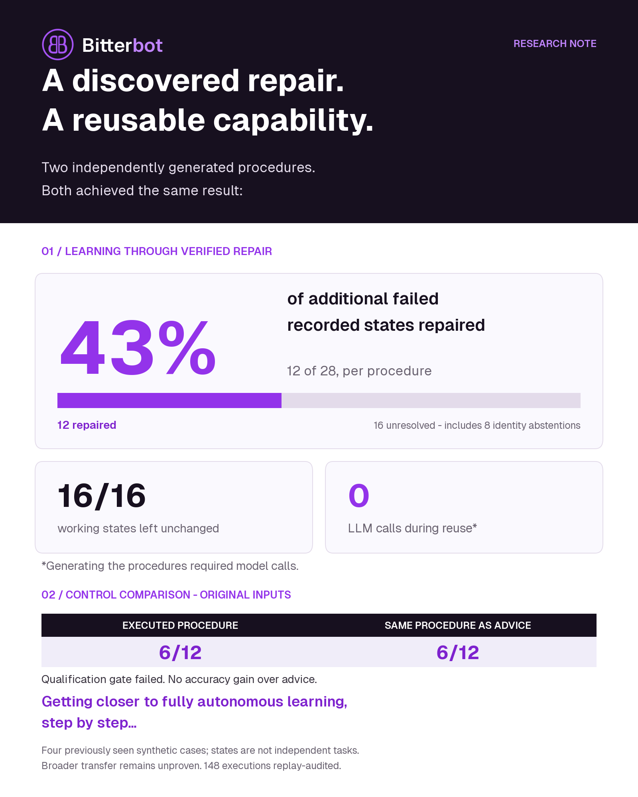

# Bitterbot: conditional repair reuse

This is a compact evidence bundle for the `telecom-guarded-procedure-v1` development study. The complete raw study archive and replay dependencies are packaged under [`../../data`](../../data/README.md). The LinkedIn text is a draft; merging this bundle does not post it.

Two independently generated procedures each repaired **12 of 28 additional failed recorded states (42.9%, rounded to 43%)**, preserved **16 of 16 already-working states without mutation**, and required **zero model calls during execution**. Generating the procedures required model calls. Both procedures matched the same artifacts supplied as LLM advice at **6/12** repairs on the original inputs. The predeclared qualification gate failed.

## Scope and complete results

The experiment uses four previously consumed synthetic telecom cases, with several recorded final states and repeated executions. The 28 failed states are not 28 independent tasks. These results do not establish general autonomous learning, ordinary-agent performance or cross-agent transfer. “Getting closer to fully autonomous learning, step by step” describes the research direction, not a measured distance to full autonomy.

| Original-input comparison | Repairs / assigned | Evaluation model calls | Native actions |
| ------------------------- | ------------------ | ---------------------- | -------------- |
| Procedure A as advice     | 6/12               | 51                     | 44             |
| Procedure A executed      | 6/12               | 0                      | 54             |
| Procedure B as advice     | 6/12               | 54                     | 48             |
| Procedure B executed      | 6/12               | 0                      | 57             |
| Raw evidence retrieval    | 5/12               | 39                     | 29             |

Four raw-retrieval attempts returned multiple actions despite the one-action contract. They were rejected before execution and remain in the denominator. The 6-versus-5 contrast therefore does not establish a clean reasoning advantage over raw retrieval.

Each procedure then ran on all 44 other eligible recorded states for the same four cases: 28 failed and 16 healthy. Each repaired 12/28 failed states and preserved all 16 healthy states with zero writes. Eight failed states lacked sufficient public identity information; the procedures abstained, and those states remained in the denominator. Repeated deterministic executions are not independent statistical samples.

Procedure A made four false success claims: three repetitions on one original input and one additional-state execution. Independent native grading rejected all four. Procedure B made no false success claims but had the same repair coverage. The study failed its declared thresholds; reserved recipient cases were not used.

The model generated both artifacts from previous public failed traces, diagnostic observations, and verified repair/omission evidence. There were no human edits to the generated procedures and no outcome-driven revisions during evaluation. The host provided the bounded procedure language, validation rules, tool adapter and experiment design. Synthetic diagnostic execution had privileged access to account and device tools.

## Evidence files

- [Analysis and measurement review](evidence/analysis.json): all arms, additional-state counts, failures and interpretation.
- [All 148 assigned trial rows](evidence/trials.jsonl): no dropped failures or abstentions.
- [Frozen protocol](evidence/protocol.json): assignments, conditions, limits and qualification gate.
- [Both generated procedures](evidence/artifacts.json): the artifacts evaluated as advice and executable behavior.
- [Completion record](evidence/complete.json): original aggregation and cost ledger totals.
- [Replay audit result](evidence/audit.json): 148 executions, 147 exact provider requests and 461 native actions reconstructed.
- [Manifest](manifest.json): SHA-256 hashes for packaged files and the source analysis/audit.
- [Branded PNG](linkedin-graphic-branded.png), [vector SVG](linkedin-graphic-branded.svg), and [branding source](style-reuse-bitterbot.py). These use the repository's official logo and Geist font, with the supplied architecture proposal's plum, purple and lavender palette. The earlier graphic remains preserved separately.

This is a compact derived bundle, not the complete reproducibility archive. Raw provider requests/receipts, source snapshots, original native transcripts, and replay dependencies are preserved in the [benchmark archives](../../data/README.md). Restore them to `benchmarks/learning-strategy/results/` to replay. The audit is a recorded integrity result; its presence does not itself establish efficacy or independent external replication.

Project repository: [Bitterbot-AI/bitterbot-desktop](https://github.com/Bitterbot-AI/bitterbot-desktop). The repository is public. This bundle and its raw archives accompany the research implementation on `main`.
