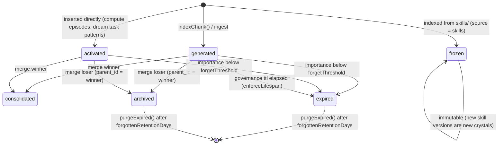
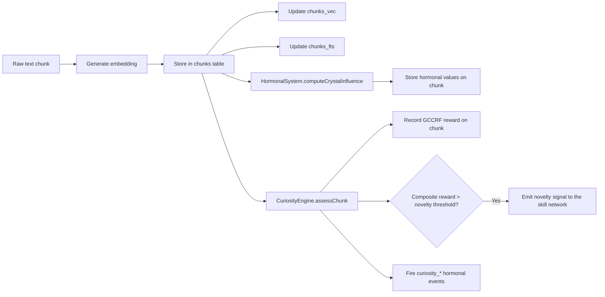

# Knowledge Crystals — Core Memory Unit

A **Knowledge Crystal** is the fundamental memory unit in the Bitterbot memory system. Every piece of indexed content — file snippets, conversation excerpts, dream insights, skills — is stored as a crystal in the `chunks` table. Crystals carry rich metadata: lifecycle state, governance scope, hormonal influence, provenance lineage, and importance scores that decay over time following an Ebbinghaus-inspired formula.

**Key source files:** `crystal-types.ts`, `crystal.ts`, `importance.ts`, `consolidation.ts`, `hormonal.ts`, `governance.ts`, `pipeline.ts`

---

## Memory Crystals vs Knowledge Crystals

Bitterbot formally distinguishes two crystal types:

- **Memory Crystals** (episode, preference, relationship, fact, goal) — private, autobiographical, never leave the node
- **Knowledge Crystals** (skill, task_pattern) — executable, procedural, eligible for P2P marketplace

This document covers Knowledge Crystals. For Memory Crystals, see the main memory architecture documentation.

### Marketplace Pricing

Knowledge Crystals are automatically priced by the marketplace economics engine:

- **Base price:** Configurable (default $0.01 USDC, `basePriceUsdc` in `skill-pricing.ts`)
- **Quality multiplier:** successRate alone (the reward-score column is always NULL at the source, so it is not used)
- **Demand multiplier:** 1 + log(downloadCount + bountyMatches + 1) × 0.1
- **Reputation multiplier:** max(0.1, publishing agent's peer reputation score)
- **Scarcity bonus:** by count of similar skills on the network: 1.5x for 2 or fewer, 1.2x for 3 to 5, 1.0x otherwise

Skills must pass quality gates before listing: minimum 3 executions and 60% success rate (`minExecutionsForListing`, `minSuccessRateForListing`).

---

## Crystal Anatomy

The `KnowledgeCrystal` type (`crystal-types.ts`) defines about 40 fields across several categories. A few per-crystal attributes documented below exist only as columns on the `chunks` table and are not surfaced on the type; those are marked as columns.

### Payload

| Field       | Type       | Description                       |
| ----------- | ---------- | --------------------------------- |
| `id`        | `string`   | UUID primary key                  |
| `text`      | `string`   | The actual memory content         |
| `embedding` | `number[]` | Primary semantic embedding vector |

### Descriptive Metadata

| Field                   | Type                  | Description                              |
| ----------------------- | --------------------- | ---------------------------------------- |
| `path`                  | `string`              | Source file path (relative to workspace) |
| `source`                | `MemorySource`        | `"memory"` \| `"sessions"` \| `"skills"` |
| `startLine` / `endLine` | `number`              | Line range in source file                |
| `hash`                  | `string`              | Content hash for deduplication           |
| `semanticType`          | `CrystalSemanticType` | Classification (see below)               |
| `origin`                | `CrystalOrigin`       | How it was created (see below)           |

### Semantic Types

```typescript
type CrystalSemanticType =
  | "fact" // Factual knowledge
  | "preference" // User preference
  | "task_pattern" // Recurring task pattern
  | "skill" // Executable skill
  | "episode" // Episodic memory (event)
  | "insight" // Dream-synthesized insight
  | "relationship" // User relationship/social
  | "goal" // User goal/objective
  | "general"; // Default
```

### Origins

```typescript
type CrystalOrigin =
  | "indexed" // File-based memory
  | "session" // Conversation transcript
  | "skill" // Crystallized skill
  | "dream" // Dream synthesis output
  | "user_input" // Direct user statement
  | "inferred" // Extracted by LLM
  | "peer"; // Received from P2P peer
```

### Behavioral Fields

| Field               | Type                        | Description                                                                                                                                                                                                                                               |
| ------------------- | --------------------------- | --------------------------------------------------------------------------------------------------------------------------------------------------------------------------------------------------------------------------------------------------------- |
| `importanceScore`   | `number`                    | 0-1, recalculated by consolidation engine                                                                                                                                                                                                                 |
| `accessCount`       | `number`                    | Times retrieved in search results                                                                                                                                                                                                                         |
| `lastAccessedAt`    | `number \| null`            | Timestamp of last search hit                                                                                                                                                                                                                              |
| `emotionalValence`  | `number \| null`            | Derived at ingestion time as `dopamine + oxytocin - cortisol`, clamped to [-1, 1]; `null` when the sum is below 0.05 in magnitude (`manager-embedding-ops.ts`). Influences dream seed selection, Ebbinghaus decay resistance, and limbic bridge feedback. |
| `hormonalInfluence` | `HormonalInfluence \| null` | Dopamine/cortisol/oxytocin snapshot at ingestion time                                                                                                                                                                                                     |
| `curiosityBoost`    | `number`                    | Legacy boost field (backward compat). The current GCCRF score is stored in the `curiosity_reward` column, which is not on the type                                                                                                                        |
| `dreamCount`        | `number`                    | Times processed in dream cycles                                                                                                                                                                                                                           |
| `lastDreamedAt`     | `number \| null`            | Last dream processing timestamp                                                                                                                                                                                                                           |
| `last_ripple_count` | column, `INTEGER`           | Poisson-sampled ripple count from last replay (enables spaced repetition prioritization). Added by `dream-schema.ts`; not on the type                                                                                                                     |
| `steeringReward`    | `number`                    | -1 to 1, accumulated from skill execution outcomes                                                                                                                                                                                                        |
| `epistemic_layer`   | column, `TEXT`              | Knowledge type as a plain string: `experience`, `directive`, `world_fact` or `mental_model`. Populated by the session extraction pipeline. Directives (explicit user preferences) take priority over inferred knowledge. Not on the type                  |

### Verification & Bounties (Phase 3)

These live as `chunks` columns (`migrations.ts`), not as fields on `KnowledgeCrystal`:

| Column                  | Type               | Description                                                   |
| ----------------------- | ------------------ | ------------------------------------------------------------- |
| `is_verified`           | `INTEGER` (0/1)    | Whether endorsed by a management node's Ed25519 signature     |
| `verified_by`           | `TEXT`             | Base64 pubkey of the management node that endorsed this skill |
| `bounty_match_id`       | `TEXT`             | ID of the bounty this crystal fulfilled (if any)              |
| `bounty_priority_boost` | `REAL` (default 0) | Reward multiplier from the matched bounty                     |

### Versioning (Skills)

| Field               | Type             | Description                             |
| ------------------- | ---------------- | --------------------------------------- |
| `stableSkillId`     | `string \| null` | Persistent ID across skill versions     |
| `skillVersion`      | `number`         | Increments on each new skill version    |
| `previousVersionId` | `string \| null` | Crystal ID of the prior version         |
| `deprecated`        | `boolean`        | Whether superseded by a newer version   |
| `deprecatedBy`      | `string \| null` | `stableSkillId` of the replacement      |
| `skillTags`         | `string[]`       | Categorization tags                     |
| `skillCategory`     | `string \| null` | e.g. `"code-generation"`, `"debugging"` |

---

## Lifecycle

Crystals progress through a defined lifecycle. The stored transitions are written by the consolidation engine and governance; `activated` is not a stored transition (see below):



Notes on what the code actually does:

- No code path writes `generated -> activated`. The `activated` label is derived at read time for legacy rows (`crystal.ts` `mapLifecycle()`: `lifecycle_state='active'` with importance >= 0.8) and in status counts (`manager.ts` `getCrystalStatus()`), or set directly at insert by compute episodes and dream task patterns.
- `archived` is written only as the loser of a merge. Low importance goes straight to `expired`.
- The consolidation engine rescans only `generated` and `activated` rows that are not `frozen` (`consolidation.ts` `loadLiveChunks()`), so `consolidated` winners are never rescored or forgotten by it.
- Each lifecycle write also updates the legacy `lifecycle_state` column (`forgotten` for `expired` and `archived`) via `setChunkLifecycle()` in `chunk-writer.ts`.
- `purgeExpired()` runs every maintenance tick and physically deletes `expired`/`archived` rows (plus their `chunks_vec` and `chunks_fts` rows) older than `memory.consolidation.forgottenRetentionDays` (default 14; a negative value disables the purge).

```typescript
type CrystalLifecycle =
  | "generated" // Just created/indexed
  | "activated" // Frequently accessed, high importance
  | "consolidated" // Merged with related crystals
  | "archived" // Low importance, retained for lineage
  | "expired" // Marked for purge
  | "frozen"; // Immutable (skills, critical memories)
```

**Transition rules (in `ConsolidationEngine.run()`):**

- Skills (`memory_type='skill'`) are immune to decay — they never reach `expired`; `frozen` rows are not loaded at all
- Crystals below `forgetThreshold` (default 0.02) transition to `expired`
- Merged crystals: the winner becomes `consolidated`, the loser becomes `archived` with a `parent_id` pointing to the winner
- All transitions are logged to `memory_audit_log`

---

## Governance Model

Each crystal carries a `CrystalGovernance` object stored as JSON in the `governance_json` column:

```typescript
type CrystalGovernance = {
  accessScope: "private" | "shared" | "public";
  lifespanPolicy: "permanent" | "ttl" | "decay";
  ttlMs?: number;
  priority: number;
  sensitivity: "normal" | "personal" | "confidential";
  provenanceChain: string[];
  peerOrigin?: string;
};
```

### Access Control (`MemoryGovernance.canAccess()`)

| Scope          | Who can access                         |
| -------------- | -------------------------------------- |
| `confidential` | Only `local_agent`                     |
| `private`      | Only `local_agent`                     |
| `shared`       | `local_agent` + authenticated sessions |
| `public`       | Anyone                                 |

Expired crystals always return `false` regardless of scope.

### Sensitivity Detection (`MemoryGovernance.tagSensitivity()`)

Content is automatically classified via regex patterns (the patterns live in `guest-access.ts`; governance delegates to them):

- **confidential**: password, passphrase, secret, API key, token, bearer, credential, private/SSH key, seed or recovery phrase
- **personal**: self-referential identity and health/finance terms ("my name", "my email", "my phone", home address, birthday, SSN, credit card, bank account, diagnosis, medication, therapist, salary) and first-person opinion markers ("i feel", "i think", "personally", "my opinion", "my preference")
- **normal**: everything else

### Lifespan Policies

| Policy      | Behavior                                                             |
| ----------- | -------------------------------------------------------------------- |
| `permanent` | Never automatically expired                                          |
| `ttl`       | Expired after `ttlMs` milliseconds (enforced by `enforceLifespan()`) |
| `decay`     | Subject to Ebbinghaus decay in consolidation cycles                  |

### Provenance DAG

Each crystal can have a `provenanceDag` (array of `ProvenanceNode`) tracking its full derivation history:

```typescript
type ProvenanceNode = {
  crystalId: string;
  operation: "created" | "mutated" | "merged" | "imported" | "forked";
  actor: string; // "local_agent" | "dream_engine" | "peer:<pubkey>"
  timestamp: number;
  parentIds: string[]; // multiple parents for merges
  metadata?: Record<string, unknown>;
};
```

`MemoryGovernance.getDerivationTree()` recursively builds the tree up to depth 5. `getAttributionChain()` returns all unique actors in the lineage via BFS.

---

## Hormonal System

The `HormonalStateManager` (`hormonal.ts`) maintains three hormone levels that modulate memory behavior. Each hormone decays exponentially with a configurable half-life.

### Hormone Channels

| Hormone  | Signal             | Half-life (default) | Trigger patterns (examples; the full regex lists are in `hormonal.ts`)       |
| -------- | ------------------ | ------------------- | ---------------------------------------------------------------------------- |
| Dopamine | Reward/achievement | 30 min              | "success", "fixed", "resolved", "shipped", "deployed", "merged", "works"     |
| Cortisol | Stress/urgency     | 60 min              | "fail", "error", "bug", "crash", "broken", "stuck", "doesn't work", "urgent" |
| Oxytocin | Social/relational  | 45 min              | "thank", "please", "help", "appreciate", "grateful", "sorry", "welcome"      |

### Event Types and Spike Magnitudes

The five text-detected events and their spikes:

```typescript
// Spike values (added to current level, clamped to [0, 1]):
reward:      { dopamine: 0.3, cortisol: 0,   oxytocin: 0   }
error:       { dopamine: 0,   cortisol: 0.3, oxytocin: 0   }
social:      { dopamine: 0,   cortisol: 0,   oxytocin: 0.3 }
achievement: { dopamine: 0.4, cortisol: 0,   oxytocin: 0.2 }
urgency:     { dopamine: 0,   cortisol: 0.4, oxytocin: 0   }
```

The `HormonalEvent` union also carries smaller programmatic events fired by other subsystems, each with its own spike in `EVENT_SPIKES`: `curiosity_high`, `curiosity_progress`, `curiosity_aligned`, `curiosity_stagnant`, `curiosity_bonding` (GCCRF), `marketplace_sale`, `recall_positive`, `recall_negative`, `recall_relational` (limbic memory bridge), and `compute_success`, `compute_setback` (compute pools).

### Decay Formula

Hormones decay toward homeostasis (a personality-defining resting state), not toward zero:

```
hormone(t) = homeostasis + (hormone(t₀) - homeostasis) * 0.5^((t - t₀) / halflife)
```

Default homeostasis: dopamine=0.15, cortisol=0.02, oxytocin=0.20. Values below 0.001 are clamped to 0.

### How Hormones Influence Memory

1. **Consolidation modulation** (`getConsolidationModulation()`):
   - `decayResistance` = effectiveCortisol\*0.3 + dopamine\*0.2 + oxytocin\*0.2 (max 0.5) — high stress slows memory decay
   - `mergeThreshold` = 0.92 + effectiveCortisol\*0.03 — stress makes merging more conservative
   - `haltUntrustedIngestion` — `true` when a network cortisol override is active (see below)

2. **Retrieval modulation** (`getRetrievalModulation()`):
   - `importanceBoost` = 1 + dopamine\*0.2 — reward state boosts important memories
   - `recencyBias` = 1 + cortisol\*0.3 — stress favors recent memories

3. **Per-crystal influence** (`computeCrystalInfluence()`):
   - Detects hormonal events in text via keyword patterns
   - Session-origin content gets +0.1 oxytocin baseline
   - Stored as `HormonalInfluence { dopamine, cortisol, oxytocin }` on each crystal

### Network Cortisol Override (Phase 3)

Management nodes can broadcast a **hormonal weather event** — a signed cortisol spike that propagates across the entire P2P swarm via Gossipsub. When received:

1. `HormonalStateManager.applyNetworkCortisolSpike(level, durationMs, reason)` sets an override
2. `getState()` returns `cortisol = max(localCortisol, networkOverrideLevel)`
3. `getConsolidationModulation()` uses `effectiveCortisol` (the max of local and network) for all calculations
4. `haltUntrustedIngestion` becomes `true`, which causes `SkillNetworkBridge.ingestNetworkSkill()` to reject skills from peers whose trust level is below `"trusted"`

The override auto-expires after `durationMs` milliseconds. This is the network's **immune response** — if a management node detects a Sybil attack or poisoned skill wave, it broadcasts a cortisol spike to lock down untrusted ingestion across all edge nodes simultaneously.

```typescript
// Management node broadcasts via OrchestratorBridge:
await orchestratorBridge.publishWeather(0.9, 300_000, "suspicious skill burst from peer cluster");

// All edge nodes automatically:
// 1. Raise cortisol to 0.9 for 5 minutes
// 2. Halt untrusted/provisional peer skill ingestion
// 3. Increase decay resistance (stressed memories harder to forget)
// 4. Tighten merge threshold (more conservative merging)
```

---

## Consolidation Engine

The `ConsolidationEngine` (`consolidation.ts`) runs periodically (default: every 30 minutes, `memory.consolidation.intervalMinutes`) as step 2 of the memory maintenance cycle and performs six phases plus a near-merge discovery sub-step:

It runs in the gateway process on the event loop with the synchronous SQLite driver, so it loads the live set in batches of 50 rows with a yield between batches, and the two per-tick lookups that usually match nothing (pending GCCRF scores, TTL-governed crystals) are served by partial indexes. Before that (2026-10-03 soak), each tick ran three cold full scans of `chunks`, about 5 seconds of blocked I/O each on a 6,000-crystal store with a small page cache.

### Phase 1: Score All Chunks (Ebbinghaus Decay)

Every crystal's importance is recalculated from scratch using `calculateImportance()`:

```
I(t) = S(t) * f(accessCount) * e^(-λ_eff * Δt)
```

Where:

- **S(t)** = a per-type relevance: preference and goal 1.2; task_pattern, insight and relationship 1.1; fact and skill 1.0; episode and general 0.8
- **f(n)** = `1 - e^(-0.2 * (n + 1))` — saturating frequency factor
- **Δt** = milliseconds since last access
- **λ_eff** = `decayRate * (1 - |emotionalValence| * emotionDecayResistance)`

Importance is determined by the memory's type, its access pattern and time. Emotional valence slows decay but doesn't inflate scores. Two adjustments follow: well-spaced reuse multiplies the score by up to 1.3 (spacing effect), and open loops are held at no less than twice the forget threshold.

### Phase 2: Identify Forgotten Chunks

Crystals scoring below `forgetThreshold` (default 0.02) are marked `expired` — except skill-type chunks which are immune to decay.

### Phase 3: Merge Overlapping Promoted Chunks

Crystals scoring above `promoteThreshold` (default 0.7) are candidates for merging; only the top `PAIRWISE_MERGE_CHUNK_CAP` candidates by score enter the pairwise sweep. Two promoted crystals from the **same file path** with cosine similarity >= `mergeOverlapThreshold` (default 0.92) are merged: the higher-importance one becomes `consolidated`, the lower one becomes `archived` with `parent_id` set.

### Phase 3b: SNN Near-Merge Discovery

Among the surviving chunks (same cap), pairs in the near-miss cosine zone below the merge threshold that share enough nearest neighbours are written to the `near_merge_hints` table for the dream engine to consume. Consumed hints and hints older than 14 days are deleted on the same pass.

### Phase 4: Apply Changes (Transaction)

All score updates, lifecycle transitions, and merges are applied in a single SQLite transaction. Every transition is logged to `memory_audit_log`.

### Phase 5: Decay Steering Rewards

`steering_reward` values are decayed so they cannot accumulate without bound.

### Phase 6: Anti-Catastrophic Forgetting

Orphan clusters (groups of related chunks whose neighbourhood has thinned out) are detected, capped at 100 rows, and queued for dream replay so a whole topic cannot silently fade.

### Configuration

```typescript
type ConsolidationConfig = {
  decayRate: number; // Default: 5e-10 (~16-day half-life)
  promoteThreshold: number; // Default: 0.7
  forgetThreshold: number; // Default: 0.02 (scaled down by up to half as curiosity maturity approaches 1)
  mergeOverlapThreshold: number; // Default: 0.92 (raised by 0.03 × cortisol at run time)
  emotionDecayResistance: number; // Default: 0.5 baseline; the current hormones add to it, up to 0.8
};
```

The manager builds the engine per tick (`manager.ts` `consolidate()`): the user's `memory.consolidation.*` values are the baseline, `getConsolidationModulation()` supplies the run-time merge threshold and the hormonal addend to decay resistance, and `resolveEmotionDecayResistance()` caps the result at 0.8.

---

## Indexing Pipeline

When new content is synced (file change, session update, skill addition), the indexing flow in `manager-embedding-ops.ts` processes each chunk:



Skill content (`source === "skills"`) is written with `lifecycle = 'frozen'` at this point; everything else starts as `generated`.

The curiosity config still accepts `boostThreshold` (default 0.4) and `boostMultiplier` (default 1.3), but nothing reads them after parsing: `assessChunkCuriosity()` in `manager.ts` records the reward, emits the novelty signal and fires hormonal events, and does not change `importance_score`. They are configured but not applied.

The `MemoryPipeline` class (`pipeline.ts`) provides a fluent API for custom retrieve-filter-augment-store workflows:

```typescript
const result = await MemoryPipeline.create()
  .retrieve("query", { semanticType: "skill", limit: 20 }) // opts also accept `lifecycle`
  .filter((c) => c.importanceScore > 0.5)
  .augment((c) => ({ ...c, importanceScore: c.importanceScore * 1.1 }))
  .store()
  .execute(db);
```

---

## Related Documentation

- [Architecture Overview](./architecture-overview.md) — system entry point and file map
- [Dream Engine](./dream-engine.md) — offline processing and insight generation
- [Skills Pipeline](./skills-pipeline.md) — skill lifecycle and P2P network
- [Curiosity & Search](./curiosity-and-search.md) — curiosity engine and retrieval
