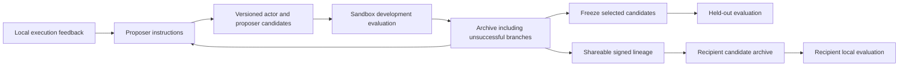

The strategy lab is a host-only experimental capability of the existing procedural-learning service. It does not start a background job, alter the live harness, or publish to the public network. Access `service.strategies` on a configured `ProceduralLearning` instance. The store must be in `shadow` mode; active and off stores reject lab work. Construction is lazy and uses additional tables in the existing database.

Hosts obtain the existing per-agent service with `getProceduralLearning({ cfg, agentId })` from the plugin SDK. The returned service may be null when procedural learning is disabled. A typical experiment registers development and held-out panels, adds the starting strategy with `archive.add`, evaluates it, proposes and evaluates children, selects from `archive.rank(developmentPanelId)`, and freezes the chosen hashes with `archive.seal` before final evaluation. The runnable benchmark below demonstrates this complete sequence, including fixed-proposer controls and recipient imports. Registering a panel is a trusted host operation; the `isolation` declaration is not itself an operating-system sandbox.

A strategy contains an actor instruction, a proposer instruction, exact compatibility scope, immutable parent hashes, a sharing declaration and an expiry. Only these typed data fields are accepted. Strategy data cannot register tools, change permissions, modify GENOME, replace outcome verification, or execute source code. Hosts register sandbox adapters through `registerPanel`, pinning the model, verifier revision, task inputs and development/held-out partition.

`evaluate` executes the actual actor through the host adapter and then calls the independently registered verifier. Complete development batches can rank candidates. Unsuccessful candidates remain available for exploration, but partial batches, invalid verifiers and unresolved costs cannot create a selectable result. `propose` supplies only local development feedback to a host model callback. It supports a fixed-proposer control and an evolving proposer. Generated edits have separate accounting and never count as successful task execution merely because their schema is valid.

For small corrections, `propose({ editMode: "append", evolveProposer: false, ... })` accepts only `{ append: string }`, bounded to 600 characters. The lab appends that text to the unchanged parent actor, retains the host's fixed proposer, and enforces the existing 4000-character actor limit. It rejects replacement fields and proposer evolution in this mode. Malformed generated edits still incur their actual generation cost. This preserves the original text, but additions can still contradict or distract from it; behavioral regression gates remain necessary. Omitting `editMode` preserves the existing replacement behavior.

`editMode: "conditional"` accepts only `{ reminders }`, preserves the parent actor text, and requires a fixed proposer. A strategy can carry at most four bounded rules over Boolean/unknown observations, with optional suppression predicates. The host must pin its supported `reminderFacts` vocabulary in the panel and interpret observations through an episode-local `StrategyReminderSession`; unsupported vocabularies are rejected before execution. The session suppresses repeated advice for unchanged evidence and supports explicit invalidation and reset. It never reads a task or verifier. The [completed conditional reminder experiment](conditional-reminders-experiment.md) passed replay auditing but failed its exploratory gate; no reminders activated in six conditional episodes. Hosts need observation-coverage qualification as well as outcome verification before claiming mechanism benefit. Rule data remains subject to the existing provenance, expiry, shadow-mode and transfer restrictions.

A panel may pin `feedbackLimit` between 1 and 32000 characters when the default 6000-character development feedback limit loses useful observations. This limit becomes part of the immutable panel identity. It does not change held-out feedback isolation or sharing rules. Hosts should construct bounded, redacted evidence before evaluation; increasing the limit does not make private conversations shareable. The telecom adapter uses ordered actor-visible dialogue and selected account fields from synthetic source cases, explicitly excluding private customer tool results.

The lab reuses the procedural resource ledger. Every proposal or execution reserves costs before dispatch. Unknown spending blocks further operations in that store. The host must reconcile actual receipts; interruption is not a free call. Cooperative cancellation and sandbox enforcement remain host responsibilities. Existing procedural shutdown waits for in-flight lab operations before closing SQLite.

This extends instruction and workflow learning; it does not train model weights. The database boundary is per agent, following the existing service. A shared agent is not automatically partitioned by individual user. Multi-user operation still needs explicit consent, feedback redaction and an appropriate tenant boundary before a learning panel can be marked shareable.

`archive.seal(scope, hashes)` freezes candidate selection before held-out execution. Sealed scopes reject further search. Held-out results cannot rank parents or appear in proposal feedback, and a held-out candidate/panel combination cannot implicitly rerun. Exact input hashes catch identical cross-partition inputs; the host must additionally ensure semantic and task-family separation. Adaptive development scores are not final generalization estimates.

A seal is permanent within that store and scope. This first implementation supports finite research studies; it has no automatic experiment-epoch rollover or always-on learning scheduler. Run a new independent study in an isolated store rather than deleting a seal to continue tuning on an exposed final panel. Ordinary procedural learning is unaffected by a strategy seal.

The archive supports explicit withdrawal with transitive descendant invalidation. Expired or missing ancestors also make descendants unavailable. No strategy receives an active-skill state. A proposal trained on a private panel remains private even when its parent was shareable. Hosts must explicitly mark a panel's complete feedback as shareable before inheriting shareable provenance; this is a data-governance declaration, not an automatic privacy classifier.

`exportStrategyPacket` requires local development execution and shareable, available ancestry. `importStrategyPacket` checks the existing native Ed25519 envelope signature and content hash and atomically imports the bounded lineage. It imports no source qualification, authority, or executable capability. The receiving host evaluates applicability and behavior in its own environment. The ordinary filesystem loader quarantines strategy packets; manual skill acceptance and crystal ingestion reject them. There is no strategy auto-publication route.

Development evaluation is not qualification for production and does not prove a sharing decision safe. Hosts should provide only redacted, bounded feedback and retain private user information locally. Distinct signing keys do not establish independent experiments. Global reputation and consensus are outside this initial implementation.

The [experiment harness](../../benchmarks/learning-strategy/README.md) implements a bounded 2-by-2 study and separate recipient comparisons. Its synthetic functions, strong outcome oracle and small search population limit generalization. Actual 24-hour retention, live Rust mesh propagation, real-user benefit and deployment-level performance are not established by engineering qualification.

## Main integration boundary

The service is opt-in through `memory.proceduralLearning`; absent configuration or `mode: "off"` returns no service. The strategy lab requires `mode: "shadow"`. This merge exposes the host SDK and isolated research harness; it does not wire lessons into live prompts, start dream learning jobs, or automatically publish candidates. Existing gateway staging and promotion controls remain in place. Signed research packets cannot become active filesystem skills through trust or manual acceptance.
