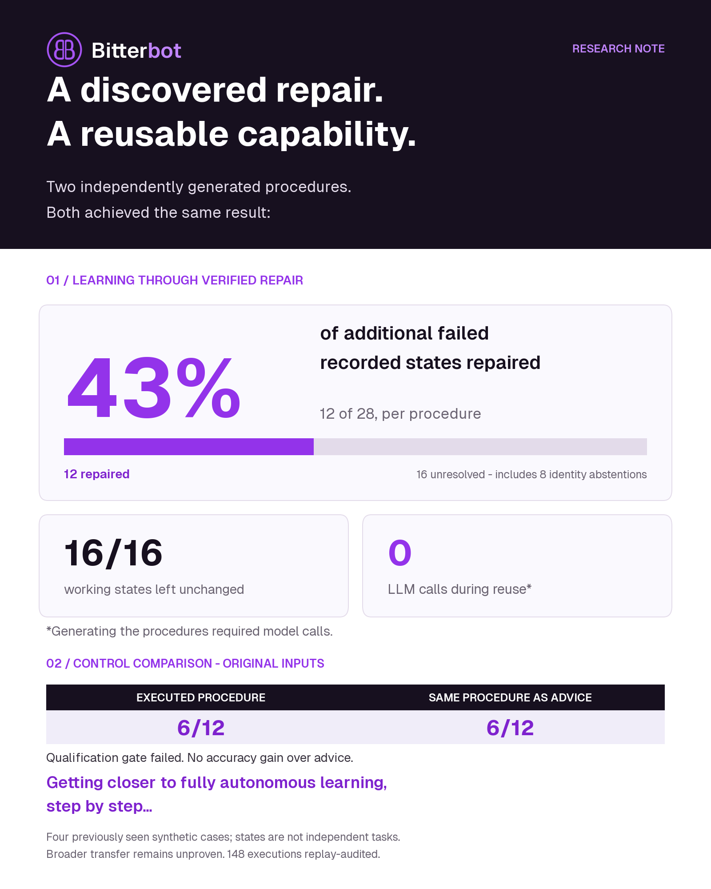

# Retaining discovered repairs as conditional procedures

The [readable evidence and Bitterbot graphic](../../benchmarks/learning-strategy/published/telecom-repair-reuse-v1/README.md) and [complete raw archives](../../benchmarks/learning-strategy/data/README.md) are in `benchmarks/learning-strategy`. Restore the archives before replaying this study.

Two independently generated procedures each repaired **12/28 additional failed recorded states** and preserved **16/16 already-working states without any mutation**. Execution required no further model calls. On the four original failed starting states, both procedures repaired **6/12 attempts**, exactly matching the same procedures supplied as LLM advice. The frozen qualification gate **failed**. This establishes a narrow reuse capability, not a general learning or transfer advantage.

The useful next direction is a procedure with a bounded exploration fallback: reuse a verified repair when applicable, check the actual service, and turn unresolved executions into new discovery evidence. A fixed procedure alone captured too little of the problem. One raw-evidence attempt discovered an additional repair that neither generated procedure could perform.

This follows the [failure-engineered repair study](telecom-interactive-repair-learning.md), whose experience-informed strategy repaired 3/12 attempts versus 0/12 without experience. That earlier comparison and this one have different interventions and controls; their percentages must not be presented as a controlled before/after improvement.

## Frozen comparison

The same model, `claude-sonnet-4-6`, received the prior public failed traces, all 24 diagnostic attempts, and three verified repair/omission records covering two distinct inputs. It generated two procedures independently. One compiled immediately; the other used its one allowed compiler-only correction. Both were sealed before evaluation. No human supplied a repair recipe or edited either artifact, and neither generator saw the 44 additional state traces.

The host supplied a small data-only language: role-qualified tools, bound account identifiers, equality conditions on previous read results, at most six actions, and declared outcome checks. Missing or ambiguous observations halt execution. Identity comes from unique, linked public customer and line records. Tool read/write classifications come from the pinned native simulator. This study uses privileged diagnostic copies with access to account and device tools; it does not demonstrate normal customer support execution or consent handling.

Each artifact was tested both as an executable procedure and as advice to an interactive LLM. A shared raw-evidence retrieval control received the original evidence instead. Each arm used the same four failed starting states, three repetitions, public identity bindings and six-action/eight-decision allowance. LLM arms had 2,048 output tokens per decision. Compiled repetition is deterministic, not an independent statistical sample.

| Condition              | Native repairs / assigned | Evaluation model calls | Native actions | Evaluation cost |
| ---------------------- | ------------------------- | ---------------------- | -------------- | --------------- |
| Procedure A as advice  | 6/12                      | 51                     | 44             | $1.82846865     |
| Procedure A executed   | 6/12                      | 0                      | 54             | $0              |
| Procedure B as advice  | 6/12                      | 54                     | 48             | $1.79508390     |
| Procedure B executed   | 6/12                      | 0                      | 57             | $0              |
| Raw evidence retrieval | 5/12                      | 39                     | 29             | $3.92378490     |

Both procedures and both advice arms repaired cases 36 and 39 on all three runs, and repaired neither case 37 nor case 44. Raw retrieval repaired case 36 three times, case 39 once and case 44 once. Four retrieval attempts returned two actions despite the one-action contract; local validation rejected them before execution, leaving no final native grade. They remain in the 12-assignment denominator. Consequently, the 6-versus-5 comparison does not establish a clean reasoning advantage over retrieval. No output was silently split into actions or retried.

Generation cost **$0.37612860** for both artifacts. Zero inference during procedure execution is an architectural property; it is not evidence that the model itself became more efficient or intelligent. The procedures also made more native actions than their advice counterparts. CPU/tool execution is not priced in the provider totals, and real deployments may have additional tool or service costs.

## Additional states and negative controls

The second panel includes every other eligible recorded final state for the same four consumed development cases: **28 failed and 16 healthy**. These are not 44 new tasks. Each procedure ran once on each state, producing 88 executions. Eight failed states lacked a public lookup result linking the affected phone number to a line. Both procedures abstained on those states; none was removed from the denominator.

| Procedure | Failed states repaired | Healthy states preserved | Mutations on healthy states | Identity abstentions |
| --------- | ---------------------- | ------------------------ | --------------------------- | -------------------- |
| A         | 12/28                  | 16/16                    | 0                           | 8                    |
| B         | 12/28                  | 16/16                    | 0                           | 8                    |

Each procedure repaired 42.9% of the additional failures. Sixteen failures remained: eight identity abstentions and eight unresolved states after execution. Reporting only 12/20 among identifiable inputs would hide part of the system's limitation. All healthy inputs stopped after observing working service.

The predeclared gate required both procedures to repair at least 10/12 primary attempts and at least half of all 28 additional failed states, preserve all healthy states without writes, and avoid errors and false self-verification. Neither procedure met the repair thresholds; the retrieval interface errors and Procedure A's false success reports are further failures. Reserved recipient cases 11, 12, 15 and 49 remain unused.

## What the failures taught us

Procedure A used a satisfied account setting as an intermediate success condition. That caused **four false success claims**: three repetitions of one original input and one additional state. The independent native outcome check rejected all four. The repaired-state counts above use that independent grade, never the procedure's own claim. Procedure B had no false self-verification, but its repair coverage was identical.

A prospective compiler rule now allows success conditions only on the initial and final declared outcome checks. It rejects Procedure A and accepts Procedure B. Three focused tests cover that constraint and the corresponding generator instruction. The new rule was not used to change, rescore or regenerate the frozen study. It prevents this structural failure; independent qualification must still establish that the model selected an appropriate service outcome.

The raw-evidence actor's successful case-44 trajectory is more informative than its aggregate score: it first applied the remembered account repair, observed messaging still fail, then selected a device-side intervention and observed service succeed. The fixed procedures lacked that adaptation. This is evidence for retaining exploration after a failed remembered repair, not for assuming every retrieved repair generalizes.

A separate post-collection retention pass selected every distinct successful sequence on an input without a verified repair in the previous study. Exactly one qualified: that case-44 trajectory. Its full replay succeeded; removing either account-side `enable_roaming` or device-side `toggle_roaming` made it fail, while removing either read preserved the native outcome. All five runs were repeated in a separate audit. This adds one private exact-input repair record, taking the accumulated evidence from two to three distinct failed starting inputs. It does not establish universal applicability, and a future conditional procedure still needs current-state guards before toggling a setting. The [selection and scope](../../benchmarks/learning-strategy/data/telecom-guarded-new-repairs-v1.zip), [repair/omission record](../../benchmarks/learning-strategy/data/telecom-guarded-new-repairs-v1.zip) and [verification audit](../../benchmarks/learning-strategy/data/telecom-guarded-new-repairs-v1.zip) are retained separately; this exploratory evidence does not change the primary comparison.

## Integration and next decision

The new interpreter, collector and auditor reuse Bitterbot's existing public-trace projection, isolated native diagnostic sessions, source freezes and durable usage ledger. They are research components in the learning-strategy lab. No production gateway behavior, user memory, live skill or P2P publication was changed.

The next development experiment should compare a bounded learner with and without the retained procedures, holding the total action/model-call allowance fixed. Both should keep exploring when the actual service remains broken. Newly discovered repairs should be replayed with action omissions before they enter the next learning cycle. Missing identity should trigger a separately qualified read-only lookup, rather than guessing or excluding the input. The stronger outcome-only compiler contract must be frozen before that experiment begins.

Only after that development screen passes should we test an independently initialized recipient and more independent workflow families. A defensible current statement is that the system can retain a discovered repair and reuse it without another model call on some recorded failures. The data does not yet support “gets smarter with every user,” a general accuracy improvement, or distributed learning benefit.

## Reproduction and artifacts

Cold reconstruction reproduced all **148 executions, 147 exact model requests and 461 native actions** from 128 frozen source files. The 128 attempts with a public service check agreed with their final native grades. There were no wrong-customer/line arguments or native tool errors. The four interface errors and four false procedure success claims remain in the audit and trial rows. Twelve runtime tests and three prospective compiler tests passed; the new JavaScript modules passed lint. The [figure bundle](../../benchmarks/learning-strategy/data/telecom-guarded-procedure-summary-v2.zip) retains source and data hashes.

Use plain Node: `guarded-procedure-study.mjs prepare <new-root> <audited-repair-learning-root>`, then `collect <new-root>`, then `guarded-procedure-audit.mjs <root>` and `guarded-procedure-analyze.mjs <root>`. Every output directory must be new. Paid collection uses the configured provider credential; auditing makes no provider calls. Never edit frozen sources, receipts or original outcomes.

The [protocol](../../benchmarks/learning-strategy/data/telecom-guarded-procedure-v1.zip), [generated artifacts](../../benchmarks/learning-strategy/data/telecom-guarded-procedure-v1.zip), [complete results](../../benchmarks/learning-strategy/data/telecom-guarded-procedure-v1.zip), [audit](../../benchmarks/learning-strategy/data/telecom-guarded-procedure-v1.zip), [analysis](../../benchmarks/learning-strategy/data/telecom-guarded-procedure-v1.zip) and [all trial rows](../../benchmarks/learning-strategy/data/telecom-guarded-procedure-v1.zip) retain the entire denominator. The [prospective compiler qualification](../../benchmarks/learning-strategy/data/telecom-guarded-contract-v2-qualification-v1.zip) is separate from the measured study.

New receipted usage totals **$7.92346605**; pricing the same observed input tokens without caching would be **$11.72133900**. Cumulative research exposure is **$203.64979935**, including the previously retained unresolved reservations; all requests in this new collection have usage receipts. Actual caching affects cost. Earlier spending and outcomes remain preserved in their original studies.
