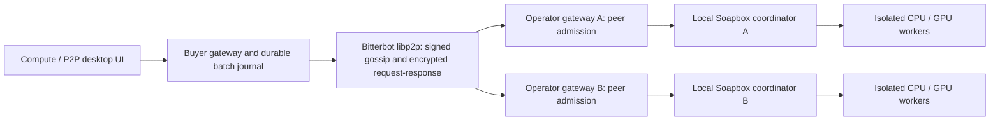

# Soapbox Compute over the Bitterbot mesh

Compute discovery is on when Bitterbot P2P is on. Sharing execution capacity requires an
operator to grant a peer access to an existing private pool or collective project. The
Compute screen and P2P dashboard show the same discovered capacity, batch progress and
local activity history.

## Sidecar compatibility

Compute discovery and signing require orchestrator **0.2.4** or newer. The normal
installer fetches the version pinned in `orchestrator/Cargo.toml` and verifies its
signed checksums. The `orchestrator-v0.2.4` binaries must be published before an app
release containing this integration is distributed. The older 0.2.3 binary
rejects the Compute topic; the gateway reports that it needs an updated
orchestrator rather than advertising capacity it cannot use.

Source builds can compile `orchestrator/` from the same revision as the gateway.
An explicitly configured older P2P binary must be updated as well.

## Building the integrated app

Compute ships in the gateway and Control UI. Use `pnpm build` and
`pnpm --filter bitterbot-control-ui build`, then the normal release workflow or
`node scripts/build-release-tarball.mjs --out release-out`. The bundled plugin
registers through the core runtime, so installed packages do not need the source
`src/` directory and use the gateway's shared payment gate.

The earlier `build-soapbox-integration.mjs` and `build-soapbox-p2p-release.mjs`
overlay builders now stop before producing an add-on. An overlay would duplicate
payment and review state from the gateway. Reproduce older standalone previews
from the source revision recorded in their release; use the integrated app for
new builds. Base Sepolia payments still use the separate Compute wallet.

## Architecture

The Rust Soapbox repository owns execution, isolation, leases and settlement. The desktop
repository owns integration with Bitterbot identity, discovery, peer transport, admission
UI and batch orchestration. It reuses Bitterbot's existing libp2p connection and relay
machinery; there is no second DHT, blockchain, wallet or publicly exposed coordinator API.

### Discovery and admission

- `bitterbot/compute/v1` is an exact allowlisted gossip topic. A descriptor is signed with
  the orchestrator's actual Ed25519 identity, domain separated from other signed data.
- Receivers verify the signature, public-key-derived PeerId, gossip author, exact schema,
  bounds and expiry. Descriptors refresh every 30 seconds and expire after two minutes.
  They contain capacity and pinned model metadata, never inputs, credentials or wallets.
  Discovery retains at most 512 peers locally. This pilot topic is not an 85,000-node
  capacity index; regional/scoped discovery and relay load testing are required at fleet scale.
- An advertisement is a self-report. It is not a benchmark certificate or proof of GPU ownership.
- The operator grants selected pools/projects in the UI. The gateway creates a durable,
  peer-specific Rust submitter principal. The runtime stores only a token hash. The raw
  credential stays in the operator gateway's protected local SQLite database.
- The `compute/v1/{access,submit,job,cancel,cancel-intent}` methods use the existing Noise-encrypted
  libp2p request-response transport. The authenticated stream peer selects its grant.
  Circle membership alone grants no Compute permission. No generic gateway method proxy exists.
- Revocation first disables gateway access, then revokes the runtime credential and cancels
  outstanding jobs. If the coordinator is unavailable, access stays disabled and the UI
  reconciliation retries automatically on service ticks and after restart.
- `cancel-intent` remains available after revocation, bound to the authenticated
  peer's public key and original batch/shard key. The admin-only runtime endpoint
  atomically records a cancellation fence and cancels any matching private/collective
  job. It never submits work, creates a grant, or returns inputs/results. The journal
  survives restart and re-admission. Missing-job entries are bounded per identity
  and globally; a full journal refuses new acknowledgements rather than dropping fences.

### Distributed workloads

Private and collective batches are partitioned into CPU SHA-256 shards (up to 16 inputs)
or pinned GPU embedding shards (one input). Results are returned in original input order.
Limits are 512 CPU inputs or 32 GPU inputs, 32 KiB of total input, 16 selected peers and
16 active batches. Batches advance in round-robin order, with at most four outbound
shard steps in flight. CPU shards reserve 256 MiB; the current embedding adapter reserves
2 GiB of host memory for its isolated model runtime, independently of GPU VRAM.

The durable journal records intent before submission. Retries after a timeout or restart
reuse the same coordinator idempotency key. An ambiguous submission stays on its original
peer, avoiding duplicate work elsewhere. The runtime handles worker lease retries within
that coordinator. Preflight failure alone is not a submission attempt; such work
cancels locally. Sent or ambiguous work stays pending while a peer is offline and
retries cancellation only. The buyer validates the returned intent/job binding before
accepting acknowledgement. CPU results are recomputed by the buyer.
GPU results receive shape and pinned-runtime checks and still require trusted operators.

An isolated GPU worker acquires the host GPU reservation before registering its capacity
and claiming a job, then retains it through execution. A cached readiness probe alone
cannot authorize a claim: if another worker holds the reservation, GPU capacity is
removed from the offer until a later poll. This prevents competing coordinators on one
host from consuming execution attempts on an already occupied GPU.

Design comparisons and the next adapter priorities are in
[the related-work review](./soapbox-related-work.md).

Activity and reliability are local observations. They are not global network totals,
financial earnings or EigenTrust votes. Inputs and results are stored in the buyer's local
Compute journal and on the selected operators, so only send data those operators may see.

### Compatibility and payments

Deploy matching desktop, orchestrator and Soapbox runtime builds. Runtime capability
`mesh_admissions` prevents old coordinators from advertising unsupported sharing capacity.
The integrated Linux x64 archive includes the pinned runtime for the one-click
local pool wizard. Buyer installations need no local coordinator to submit over P2P.
An operator enrolled with an external paid coordinator uses that coordinator; hosting
an independent mesh pool is a separate choice in the wizard. See [setup](./soapbox.md).

The existing single-job paid UI remains Base Sepolia (chain 84532), with its separate
Compute wallet and explicit funding action. Mesh admissions cannot submit paid or
test-credit jobs. This increment does not implement automatic paid fan-out, aggregate
multi-operator escrow, payouts over the mesh, or mainnet payments. Mainnet funds are not
part of this subsystem.

## Growing toward pooled computing

1. **Implemented foundation:** signed capacity discovery, explicit peer access, encrypted
   submission, private/collective batches, ordered results, restart recovery, local activity.
2. **Wider pilot:** validate the integrated one-click operator release on two
   physical machines, relay/NAT testing with updated relay binaries, bandwidth and workload
   benchmarks, scoped capacity indexes, disk retention controls, release/rollback packaging.
3. **Paid mesh:** buyer-approved total budget, immutable per-shard quotes, separate Sepolia
   escrow per operator, aggregate progress/refunds, restart and duplicate-payment tests.
   Connect measured completion evidence to reputation without counting it twice.
4. **Broader pooled utility:** independently verified embedding replicas, evaluation and
   simulation batches, approved inference adapters, content-addressed artifacts and explicit
   storage/cache durability contracts. Each adapter needs a quota, isolation profile and
   verification policy before it is advertised.
5. **Specialized clusters:** topology/latency benchmarks and reservations for tightly coupled
   distributed training or inference. Internet peers do not automatically become shared GPU
   memory; batch throughput is the first practical form of pooled compute.

## Validation

`scripts/compute-mesh-e2e.ts` launches three real local libp2p orchestrators with fresh
identities, two Rust coordinators and isolated workers. It tests signed discovery,
unauthorized access, private and collective CPU fan-out, idempotency, gateway restart,
pinned GPU embeddings and revocation. `SOAPBOX_BIN`, `ORCHESTRATOR_BIN` and
`SOAPBOX_SANDBOX_CONFIG` select matching builds and a pinned sandbox image. It uses no wallet
and makes no payment. Local processes share this computer's hardware; this is not a
two-physical-host acceptance result.

`scripts/compute-cancellation-e2e.ts` exercises real loopback P2P and Rust
coordinator failures: offline/denied preflight, lost submit replies, cancellation
before a delayed submit, revocation during a lease, coordinator and P2P restarts,
completed work, and cross-identity forgery. Its CPU lease driver is synthetic;
GPU execution is validated separately. It loads no wallet and sends no payments.

Colocated protocol, transport, batching, gateway authorization and UI tests cover spoofed
identity, stale/tampered metadata, frame limits, denied methods, lost responses, cancellation
recovery and stable UI submission intent. Soapbox's runtime tests cover durable admissions,
role/scope checks, job ownership, paid-mode refusal, token rotation and revocation.

### Local validation result — 2026-10-17

The acceptance script passed with three real libp2p identities, two operator coordinators
and Docker-isolated workers on this computer. Private, collective and buyer-restart
recovery batches each completed 40 CPU inputs; the pinned GPU adapter returned two
embedding rows on the RTX 4080. Peer admission and revocation also passed. The test
neither accessed a wallet nor made a payment. Its log is
`reports/compute-mesh/e2e.txt` in the desktop worktree.

| Check                                                                                  | Result          |
| -------------------------------------------------------------------------------------- | --------------- |
| Protocol, batch orchestration and shared peer transport                                | 16 tests passed |
| Gateway authorization and existing Soapbox RPC                                         | 9 tests passed  |
| Compute UI, setup and mesh panel                                                       | 14 tests passed |
| Existing Compute wallet and payment flows                                              | 17 tests passed |
| Soapbox Rust runtime, lifecycle, admissions and HTTP network                           | 34 tests passed |
| Rust P2P orchestrator                                                                  | 13 tests passed |
| TypeScript checks, targeted lint, desktop production build and both Rust binary builds | Passed          |

These are 103 distinct targeted tests, plus the real CPU/GPU acceptance flow. Two existing
Docker boundary tests remain ignored in the default Rust suite; the acceptance flow runs
real containers but does not replace their full filesystem/network/resource-limit assertions.
The final malformed-descriptor check was rerun successfully after tightening model metadata
validation. Physical-host/NAT testing and paid mesh settlement remain outstanding.

### Earlier one-click operator release candidate (rc5)

The rc5 candidate adds **Enable this GPU operator** to the existing setup wizard. It
prepares the pinned runtime, starts a supervised loopback coordinator and worker, verifies
GPU readiness, then activates the configuration. Private and collective peer access still
requires an explicit peer grant. No wallet is needed for this operator mode. The existing
paid coordinator flow remains available through the advanced setup option on Base Sepolia.

The package includes matching gateway, UI, plugin and Rust P2P sidecar builds against
Bitterbot 1.8.0. Installer rollback restores owned gateway files and P2P settings while
retaining wallet data. Eleven installer tests and a real coordinator crash/recovery smoke
test passed. The packaged wizard activated an RTX 4080 operator in a fresh profile. A
separate P2P buyer completed private and collective CPU batches and two GPU embedding jobs;
denial before admission and denial after revocation passed. Live rollback restored the
gateway/P2P settings and preserved the dummy wallet file byte for byte. Final checks passed:
27 targeted unit tests, one gateway authorization test, 15 UI tests, type checking and
staged-file type-aware lint. The final UI build was loaded and inspected after copy fixes.
The package secret scan was reviewed without identifying local credentials.
See [the public-release review](soapbox-public-release-audit.md) for secret-scan scope.

## Integrated public beta

Compute ships in the normal signed app archives from v1.10.0 onward; a beta
build, when published, uses an explicit version pin. Compute is on by default; only Linux x64 includes the pinned NVIDIA
operator archive. It is verified during packaging and again before preparation.
The packaged plugin finds that archive without an overlay or source checkout.
Base Sepolia and mainnet wallets remain separate. Follow the
[buyer and operator guide](./soapbox.md); the older overlay acceptance above is
historical evidence, not a substitute for testing the new release artifacts.

### P2P is connected, but Compute discovery is unavailable

Check the sidecar path reported in the gateway startup log. Older app versions let a source checkout's
`orchestrator/target/release` or `target/debug` binary take precedence over the
downloaded sidecar in `~/.bitterbot/bin`. An old development binary can connect to
the skill network while rejecting `bitterbot/compute/v1` with an error such as
`only bitterbot/circle/*/v1 topics allowed`.

The current resolver prefers the bundled release binary, then the installed
sidecar, and uses local Cargo builds only as a fallback. An explicit
`p2p.orchestratorBinary` still takes priority, including for intentional development
builds; update or remove an outdated override when upgrading. The beta bundles
the verified 0.2.4 sidecar and pins Soapbox rc9 for new Linux x64 operator setups.

Set `p2p.orchestratorBinary` to a versioned, signature-verified compatible release
binary (0.2.4 supports the Compute topic and descriptor signer), then restart the
gateway. Preserve the existing P2P key directory so the node keeps its identity
and grants. Compute remains on, and the separate Base Sepolia wallet is unchanged.
A successful status poll clears the UI's connection warning; failed user actions
remain visible independently of background polling.

Verify discovery with a separate peer receiving a fresh, valid signed descriptor.
The panel's advertised GPU total counts discovered remote peers, so it can be zero
on the operator itself even when that operator is advertising a GPU. Discovery
does not grant workload access: existing pool/project approval is still required.
